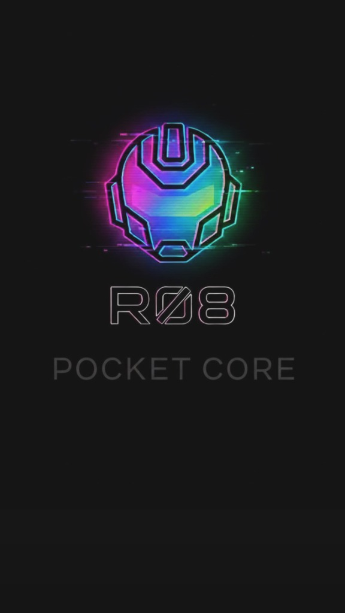

<p align="center">
  
</p>

# 🇫🇷 gpTommy 32k v4 — French vocabulary and tokenizer (Français)

[](https://www.sentinelhub.eu)   

> A **32,768-piece** vocabulary and a **lossless** tokenizer for French: every text comes back identical.
> **Author:** Thomas Seri (Sentinel) — [www.sentinelhub.eu](https://www.sentinelhub.eu)
> "32k" is the size of the vocabulary (32,768 IDs), not the context length of a model.

---

## What is new in version 4 (18 November 2026)
This version **replaces version 2** (`gptommy_tokenizer.py` 2.0.0), which stays available in the [`v2.0.0`](https://github.com/Thomasseri/gpTommy-32k-FR/tree/v2.0.0) tag. **The IDs have changed**: a model trained with version 2 must be used with version 2.
- **The space lives inside the piece** (`▁`, as in `▁motor`): single spaces between words cost no pieces; punctuation and apostrophes attach on their own.
- **Lossless capitals**: one mark for a capital initial, one for an all-caps word, one for all-caps runs and one for capitals inside names (`HTTPServer`). So "The" and "the" share the same piece.
- **Any text can be written**: 256 reserved pieces for UTF-8 bytes. `decode(encode(text)) == text` for every text.
- **Spaces, newlines and indentation as pieces**, useful for code.
- **IDs 0–31 are reserved** for chat roles and special tokens: normal text never produces them, so writing `<|system|>` inside a message does not yield the system ID.

## Measurements
Characters per piece: higher means fewer pieces for the same text. Each language with its own gpTommy v4 vocabulary.

| Language and texts | gpTommy v4 | version 2 (previous release) | GPT-2 |
| :--- | ---: | ---: | ---: |
| Italian, EU laws | **5.25** | 3.89 | 2.93 |
| Italian, 177 documents | **4.32** | 3.32 | 2.75 |
| English, EU laws | 5.02 | 4.14 (141 not lossless) | **5.29** |
| **French, EU laws** | **4.88** | 3.58 (50 not lossless) | 3.01 |
| Spanish, EU laws | **4.89** | 3.94 | 2.99 |
| German, EU laws | **4.46** | 3.29 (145 not lossless) | 2.58 |

- **Texts:** the EU machinery laws from EUR-Lex (CELEX 32006L0042, 32014L0030, 32014L0035, 32023R1230), lines of at least 20 characters; for Italian also 177 evaluation documents (not public). These texts are not among the data used to build the vocabularies.
- With gpTommy v4 **every text comes back identical**. Version 2 did not round-trip part of the English, French and German texts: those texts are left out of its count.
- On the French laws gpTommy v4 uses **27% fewer pieces** than version 2 and **38% fewer pieces** than GPT-2 (which has 50,257 pieces).

## How the vocabulary is organized
| IDs | Content |
| :--- | :--- |
| 0–31 | chat roles and special tokens (`<\|eos\|>` = 2, `<\|pad\|>` = 3, `<\|unk\|>` = 4) |
| 32–63 | capital marks, attach, spaces, newlines and indentation |
| 64–319 | the 256 UTF-8 bytes (reserve for any character) |
| 320–626 | single characters |
| 627–1,051 | elisions and other fixed pieces (`▁l'`, `▁d'`, `▁qu'`…) |
| 1,052–32,767 | 31,716 learned pieces |

The first 1,052 IDs are the same in every gpTommy v4 vocabulary. The learned pieces come from our own BPE implementation: no other vocabulary was copied.

## Usage in Python
Only the standard library is needed (tested with Python 3.9). The function names are in Italian: `carica_vocabolario` = load the vocabulary.

```python
from gptommy_v4 import carica_vocabolario, encode, decode

pv = carica_vocabolario("gpTommy_v4_FR_vocab_by_id.txt")
ids = encode("Le moteur s'arrête quand on ouvre le protecteur.", pv)
print(ids)
# [33, 1071, 6643, 653, 15700, 3785, 1316, 6849, 1071, 15436, 333]
print([pv.id_to_token[i] for i in ids])
# ['<|iniziale_maiuscola|>', '▁le', '▁moteur', "▁s'", '▁arrête', '▁quand', '▁on', '▁ouvre', '▁le', '▁protecteur', '.']
assert decode(ids, pv) == "Le moteur s'arrête quand on ouvre le protecteur."
```

## Sources and attribution
The French vocabulary was learned for 90% from French Wikipedia, dump 20231101 (CC BY-SA 3.0 / GFDL) and for 10% from source code from codeparrot/github-code-clean under permissive licenses (MIT, Apache-2.0, BSD-2-Clause, BSD-3-Clause, ISC, CC0-1.0, Unlicense). Licenses are as declared by the sources.

## Files
- `gptommy_v4.py`: the tokenizer (`carica_vocabolario`, `encode`, `decode`, `tokenizer_fingerprint`).
- `gpTommy_v4_FR_vocab_by_id.txt`: the vocabulary (one line per piece: code, card, row, ID, piece).
- `vocab.json`: piece → ID.
- `MANIFEST.json`: version and SHA-256 fingerprints of the files.

## License
Non-commercial research use, with ethical restrictions: see [LICENSE.md](LICENSE.md). For commercial licenses and partnerships: [www.sentinelhub.eu](https://www.sentinelhub.eu).

## Other languages
- 🇮🇹 **Italiano** (`gpTommy-32k`): [GitHub](https://github.com/Thomasseri/gpTommy-32k) · [Hugging Face](https://huggingface.co/SentinelHub/gpTommy-32k)
- 🇬🇧 **English** (`gpTommy-32k-EN`): [GitHub](https://github.com/Thomasseri/gpTommy-32k-EN) · [Hugging Face](https://huggingface.co/SentinelHub/gpTommy-32k-EN)
- 🇪🇸 **Español** (`gpTommy-32k-ES`): [GitHub](https://github.com/Thomasseri/gpTommy-32k-ES) · [Hugging Face](https://huggingface.co/SentinelHub/gpTommy-32k-ES)
- 🇩🇪 **Deutsch** (`gpTommy-32k-DE`): [GitHub](https://github.com/Thomasseri/gpTommy-32k-DE) · [Hugging Face](https://huggingface.co/SentinelHub/gpTommy-32k-DE)
